<div align="center">



<br /><br />

<a href="https://learn.nvc.ac.in/"></a>


</div>

## About

NVC Learn brings lectures, study materials, assignments and assessments from every department of Nabadwip Vidyasagar College into one secure place, available 24×7 on any device.

This repository holds the **Moodle 5.2 customisation** behind it: the install script, the branding script and the custom landing page, footer and styles.

## Highlights

- Lectures and study materials from every department
- Online assignments and assessments
- Secure sign-in for students and teachers
- Available 24×7 on any device
- Runs on Moodle, the open-source learning platform

## Moodle 5.2 customisation

| File | Purpose |
|---|---|
| `moodle-install.sh` | Resumable installer for **Moodle 5.2** on Ubuntu 24.04: Nginx, PHP 8.3-FPM, MariaDB 10.11 and Redis, behind a TLS reverse proxy. Database and admin passwords are generated randomly on the server and never stored here. |
| `moodle-branding.sh` | Re-runnable branding for the Boost theme: logos, colours, front-page hero, custom menu, login instructions, support contact and course categories |
| `branding/landing.html` | Front-page landing section: hero, department shortcuts, getting-started steps and repository link |
| `branding/footer.html` | Custom site footer with help links |
| `branding/nvc.scss` | Boost theme SCSS: college colours, buttons, cards and layout |
| `branding/*.png, *.jpg` | College logo and emblem |

## How to use

```bash
# on the Moodle server (as root)
bash moodle-install.sh      # first-time install; safe to re-run after a failure
bash moodle-branding.sh     # apply or re-apply the branding
```

Placeholders such as `<MOODLE_IP>`, `<PROXY_IP>`, `<ADMIN_USER>` and `moodle-support@example.edu` mark values you need to replace with your own.

> **Note:** No passwords, account details or personal data are included in this repository.

## Built with

`Moodle 5.2` · `Boost theme` · `SCSS` · `HTML` · `PHP 8.3` · `MariaDB` · `Redis` · `Nginx` · `Bash`

## Maintainer

Built and maintained by **[Dr. Amalendu Das](https://github.com/amalendu-ls)**, Librarian, Nabadwip Vidyasagar College.
[Portfolio](https://sites.google.com/nvc.ac.in/amalendudas/home_1) · [ORCID](https://orcid.org/0000-0003-0799-0599)
